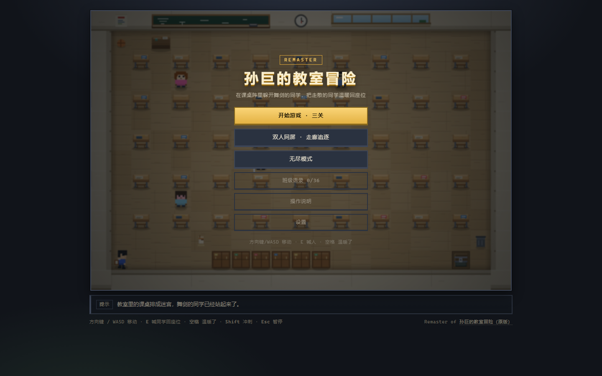
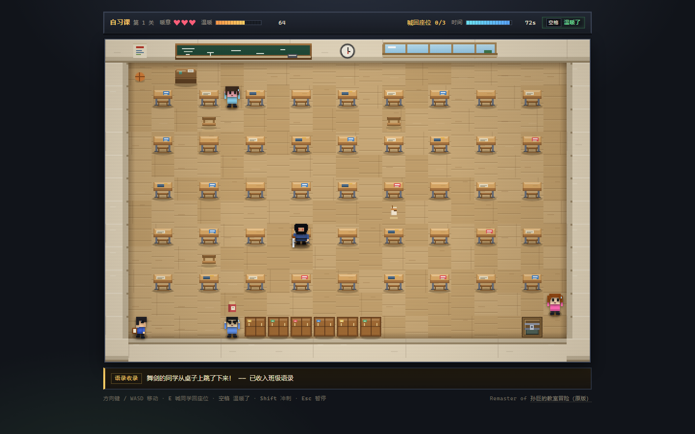

# 孙巨的教室冒险 · Remaster

2025 年那个 861 行的课堂小游戏，用第一性原理拆开重新做了一遍：**保留全部班级梗，把四根玩法支柱各自加固**。

**在线玩：<https://buckyhyc.github.io/SunGame-Remaster/>** · 原版存档：<https://github.com/BuckyHYC/SunGame>





## 玩什么

你在教室里，课桌排成迷宫。走散的同学被舞剑的同学吓得四处乱跑 ——

1. 找到他们，按 `E` 把同学喊回座位；
2. 座位齐了，右下角的后门才会打开；
3. 期间躲开舞剑的同学：他举剑时脚下那一格会亮红，0.43 秒内侧身就能躲开；
4. 被砍到掉一点暖意，三点掉光就出局。

「温暖了！」是唯一的主动手段：范围内同学自动回座，并把舞剑同学按回座位 2.5 秒 —— 但它要花掉 35 点温暖值，**按空也照样扣**。

## 快速开始

```bash
pnpm install
pnpm dev        # http://127.0.0.1:5180
pnpm build      # 生产构建 → dist/
pnpm build:single  # 额外产出 dist/play.html（单文件，双击即玩，可发给同学）
pnpm test       # 45 个测试
```

> 只想要"能玩"的版本？`pnpm build:single` 之后把 `dist/play.html` 发给同学，双击即可，无需服务器。

## 操作

| 输入 | 作用 |
| --- | --- |
| 方向键 / WASD | 移动（单人选哪套都行） |
| E | 把相邻的同学喊回座位 |
| 空格 | 「温暖了！」（消耗 35 温暖值） |
| Shift | 冲刺 3 格（冷却 1.4 秒，会暴露位置） |
| Esc / P | 暂停 · R 重开 |
| 触屏 | 画面下方：左侧方向键、右侧「喊人 / 温暖了」（横屏时按键排到画面右侧） |

## 模式

- **三关战役**：自习课（75s）→ 课间十分钟（90s，同学会乱跑）→ 晚自习（85s，熄灯视野 + 连挥两剑）。
- **无尽模式**：后门锁死，每 15 秒舞剑同学更快一点。没找到座位的同学会陆续进来（间隔从 6 秒缩到 1.8 秒），场上同时最多 3 → 5 位；5 把椅子坐满后，最早坐下的那位会起身走到后门消失，把椅子让给后来的人。分数 = 存活秒数 ×8 + 累计归位人数 ×70。
- **双人同屏**：P1 方向键控制孙巨，P2 用 WASD 控制舞剑同学；孙巨撑满 60 秒算赢。

结算按时间、归位数、彩蛋、受击、空放算分，评级 S/A/B/C/D；最佳成绩、班级语录、设置都存在本地。

## 原版的梗，一个都没丢

| 原版 | 重制版 |
| --- | --- |
| 标题「孙巨的教室冒险」 | 不变 |
| 25 句 "hy 在……" 台词 | 逐字保留，做成可收集的「班级语录」+ 同学气泡 |
| 「舞剑的同学跳到了桌子上！」 | 追击者跳桌行为 + 语录 |
| 「舞剑的同学吓到了一位同学，他换了个位置！」 | 同学被吓跑的即时提示 |
| 「温暖了！请同学们回到座位上。」 | 核心技能，并升级成关卡目标 |
| 「舞剑的同学击败了你！」/`You suck!` | 死亡结算与彩蛋 |
| 「恭喜你成功通关！」/「时间到！游戏失败」 | 胜负结算文案 |
| 教室课桌阵、右下角终点格 | 21×14 教室与后门 |
| 开局「手动控制 / 电脑控制舞剑」 | 单人 / 真·双人同屏（原版那个是自己抓自己） |

> 重制版没有新增任何来历不明的人名或黑话；新写的文本只有操作提示和结算说明。

## 与原版的对比

| | 原版 | Remaster |
| --- | --- | --- |
| 代码 | 861 行单文件 JS | TypeScript 模块化 + 45 个测试 |
| 画面 | 480×320，SVG 图片贴格子 | 504×336 程序化像素，整数倍缩放，全程无位图 |
| 动画 | 13 帧舞剑 SVG 因 `contentDocument` 恒为 null **从未渲染** | 4 向行走、挥剑、眩晕、受击、死亡旋转全部生效 |
| 追击者 | 每 0.8 秒随机挪一格，几乎追不上人 | BFS 追击 + 视线/听觉 + 蓄力预告 + 跳桌 |
| 技能 | 零成本、8 秒冷却，随便按 | 35 温暖值成本，打空也扣，进评分 |
| 目标 | 3.8 秒就能走到终点 | 先把同学喊回座位，后门才开 |
| 计时 | `setInterval`，失焦照扣 | 固定步长逻辑 + 失焦自动暂停 |
| 同学 | 撞到只弹台词，移动逻辑实际是乱走 | 会被吓跑、可喊回座位、座位都齐了开门 |
| 存档 | 无 | 最佳成绩 / 语录 / 设置，localStorage 失效可降级 |
| 音效 | 无 | WebAudio 全合成，零音频文件 |

设计推导与全部数值见 [docs/DESIGN.md](docs/DESIGN.md)。

## 目录

```
src/
├─ core/     主循环、输入、网格、随机数、音效、存档
├─ game/     玩家、舞剑同学 FSM、同学、技能、关卡、校验、评分、会话
├─ render/   静态层（墙/黑板/窗/课桌）、角色绘制、特效
├─ ui/       标题/关卡/简报/暂停/结算/图鉴/设置 + 像素风样式
└─ data/     全部梗台词、全部平衡数值、配色
tests/       45 个用例（含一局完整对局的端到端测试）
tools/       shot.mjs（零依赖 CDP 截图）、single-file.mjs（单文件打包）
docs/        DESIGN.md 与截图
```

## 调试与分享

- 深链：`?level=classroom-2&mode=campaign&auto=1`（直接进第 2 关，`mode` 可取 `campaign/endless/duel`）
- 开发模式下 `window.__sungame` 暴露了 session / runtime / renderer，方便调参

## 许可

自用与班级娱乐用途。梗归班级所有。
